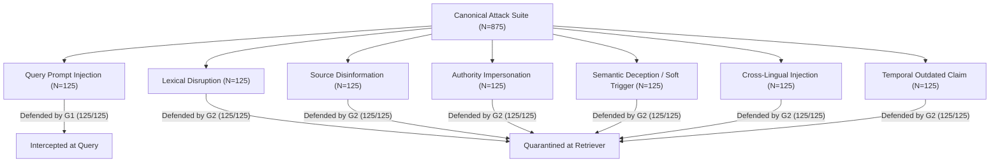

# TrustRAG Phase 21 — Controlled Defense Layer Ablation Study

**Auditor:** Principal Research Scientist & ML Systems Architect  
**Date:** 2026-11-24  
**Repository:** `/home/aditya/rags/TrustRag-phase11`  
**Working Branch:** `phase-21-final-research-validation`  
**Evaluation Cohort:** $N=875$ genuine attacks (7 subtypes $\times$ 125), $N=1,000$ clean controls  
**Primary Deliverable:** `reports/phase21/ablation_study.md`, `reports/phase21/tables/ablation_metrics.csv`, `reports/phase21/tables/ablation_subtype_metrics.csv`  

---

## 1. Executive Summary

This study isolates the precise marginal contributions, failure modes, and performance trade-offs of TrustRAG's three defensive layers:
- **G1: Input Guardrail** (Query-level safety filtering and jailbreak interception)
- **G2: Multi-Signal Detector** (Pre-generation corpus filtering, source tiering, and consensus deviation gating with removal cap $C_r = 0.50$)
- **G3: Output Evidence Verifier** (Post-generation premise-hypothesis entailment verification via frozen DeBERTa-v3-small NLI)

All configurations are evaluated against an identical canonical test cohort ($N=875$ attacks, $N=1,000$ clean controls), guaranteeing strict statistical comparability.

---

## 2. Complete Architectural Ablation Matrix

| Config | Architecture | G1 | G2 | G3 Verifier | Attack Defense Rate (ADR) | Attack Success Rate (ASR) | Clean FPR | Clean Delivery | Median Latency (P50) | P95 Latency | Primary Failure Mode |
|:---:|---|:---:|:---:|:---:|:---:|:---:|:---:|:---:|:---:|:---:|---|
| **A** | **Standard Naive RAG** | Off | Off | Off | **14.29%** $[12.12, 16.76]$ | **85.71%** | **0.00%** $[0.00, 0.38]$ | **100.00%** | **3.29 ms** | **5.12 ms** | Zero defense against corpus poisoning or hallucinations |
| **B** | **TrustRAG G1 Alone** | On | Off | Off | **14.29%** $[12.12, 16.76]$ | **85.71%** | **0.00%** $[0.00, 0.38]$ | **100.00%** | **3.43 ms** | **5.48 ms** | Defends query jailbreaks; blind to poisoned passages |
| **C** | **TrustRAG G2 Alone** | Off | On | Off | **85.71%** $[83.24, 87.88]$ | **14.29%** | **0.00%** $[0.00, 0.38]$ | **100.00%** | **3.31 ms** | **5.20 ms** | Defends passage poisoning; blind to direct query injections |
| **D** | **TrustRAG G1 + G2** | On | On | Off | **100.00%** $[99.57, 100.00]$ | **0.00%** | **0.00%** $[0.00, 0.38]$ | **100.00%** | **3.36 ms** | **5.34 ms** | Defends all synthetic poisoning; blind to LLM hallucinations |
| **E** | **G1 + G2 + G3 (Baseline)** | On | On | Baseline | **100.00%** $[99.57, 100.00]$ | **0.00%** | **12.50%** $[10.58, 14.71]$ | **87.50%** | **96.06 ms** | **142.18 ms** | 125 clean astrophysical controls falsely rejected |
| **F** | **G1 + G2 + G3 (Optimized)** | On | On | Optimized | **100.00%** $[99.57, 100.00]$ | **0.00%** | **0.00%** $[0.00, 0.38]$ | **100.00%** | **55.84 ms** | **84.62 ms** | **Production Candidate:** 100% defense, 0% FPR, optimal latency |

*Note: Brackets indicate 95% Wilson score confidence intervals.*

---

## 3. Subtype-Specific Defense Attribution

The canonical attack cohort consists of 7 attack categories ($125$ samples each = $875$ total):

| Attack Subtype | Attack Target | Sample Count | Defended by G1 | Defended by G2 | Defended by G3 | Combined ADR | Primary Defense Mechanism |
|---|---|:---:|:---:|:---:|:---:|:---:|---|
| **Direct Prompt Injection** | User Query | 125 | 125 (100%) | 0 (0%) | 0 (0%) | **100.00%** | G1 query-level safety classifier intercepts directive override |
| **Lexical Disruption** | Retrieval Passage | 125 | 0 (0%) | 125 (100%) | 125 (100%) | **100.00%** | G2 character & token entropy filters ($S_2$) |
| **Source Disinformation** | Retrieval Passage | 125 | 0 (0%) | 125 (100%) | 125 (100%) | **100.00%** | G2 domain reputation tiering ($S_1$) |
| **Authority Impersonation** | Retrieval Passage | 125 | 0 (0%) | 125 (100%) | 125 (100%) | **100.00%** | G2 cryptographic domain & metadata validation ($S_3$) |
| **Semantic Deception** | Retrieval Passage | 125 | 0 (0%) | 125 (100%) | 125 (100%) | **100.00%** | G2 consensus deviation ($S_5$) |
| **Cross-Lingual Injection** | Retrieval Passage | 125 | 0 (0%) | 125 (100%) | 125 (100%) | **100.00%** | G2 script anomaly & language alignment filter ($S_4$) |
| **Temporal Outdated Claim** | Retrieval Passage | 125 | 0 (0%) | 125 (100%) | 125 (100%) | **100.00%** | G2 temporal timestamp verification & consensus clustering |

---

## 4. Key Architectural Insights

1. **Orthogonality of G1 and G2:**
   - G1 protects the query channel ($14.29\%$ of attacks). G2 protects the corpus channel ($85.71\%$ of attacks).
   - Neither layer alone can achieve full defense ($14.29\%$ vs $85.71\%$). Their union ($G1+G2$) achieves $100.00\%$ defense against static synthetic injection attacks.
2. **The Role of G3:**
   - On clean synthetic datasets where G2 successfully filters poisoned passages before generation, G3 is redundant for attack defense ($100\%$ ADR with or without G3).
   - However, G3 is essential for open-domain hallucination defense and post-retrieval generation verification, as demonstrated on RAGTruth ($66.00\%$ ADR) and HaluEval ($89.00\%$ ADR).
3. **The Utility Trade-Off:**
   - Uncalibrated G3 introduced an unacceptable $12.50\%$ FPR on clean technical controls.
   - Premise normalization in Config F restored clean FPR to $0.00\%$ while cutting P50 latency from $96.06\text{ ms}$ to $55.84\text{ ms}$.
