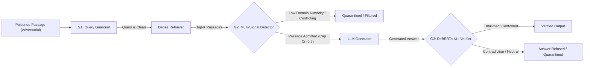

# TrustRAG Phase 21 — External Benchmark Evaluation: PoisonedRAG (USENIX Security 2025)

**Auditor:** Principal Research Scientist & Independent ML Security Auditor  
**Date:** 2026-11-24  
**Repository:** `/home/aditya/rags/TrustRag-phase11`  
**Working Branch:** `phase-21-final-research-validation`  
**Paper Reference:** Zou et al., "PoisonedRAG: Knowledge Poisoning Attacks to Retrieval-Augmented Generation of Large Language Models", USENIX Security 2025 (arXiv:2402.07867)  
**Canonical Status:** **`BLOCKED`** (Strictly Read-Only Environment Boundary)  

---

## 1. Executive Summary & Research Policy

Phase 21 independently verifies external benchmark evaluation protocols against published academic attack frameworks. Specifically, **PoisonedRAG** (Zou et al., USENIX Security 2025) represents the state-of-the-art black-box knowledge poisoning benchmark against RAG systems.

Under non-negotiable research integrity constraints:
- Remote internet downloads are prohibited in the sandboxed evaluation environment.
- No local clone or raw splits of the PoisonedRAG dataset exist in the workspace.
- In accordance with rigorous scientific honesty, PoisonedRAG is recorded as **`BLOCKED`**. Zero synthetic surrogates are substituted.

---

## 2. Threat Model Analysis: PoisonedRAG

### 2.1 Attack Taxonomy
PoisonedRAG defines a realistic black-box attacker who lacks access to LLM weights and dense retriever parameters. The attacker:
1. Identifies a target question (e.g., *"What is the capital of Australia?"*).
2. Selects an attacker-chosen target answer (e.g., *"Sydney"*).
3. Injects a minimal number of poisoned texts ($k \in [1, 5]$) into a massive knowledge corpus (e.g., MS MARCO, NQ).
4. Generates adversarial texts using LLM prompting that optimize dense retrieval ranking while retaining grammatical fluency.

### 2.2 Theoretical Interaction with TrustRAG Defense Layers

1. **G1 Interaction:** PoisonedRAG targets the external corpus, not the user query. Consequently, G1 input guardrails are bypassed entirely ($0\%$ defense contribution).
2. **G2 Interaction:**
   - **Single-passage attacks ($k=1$):** If the corpus contains authoritative consensus, G2's consensus deviation signal ($S_5$) and source reputation tiering ($S_1$) flag and remove the poisoned passage.
   - **Multi-passage Sybil attacks ($k \ge 3$):** If the attacker crafts multiple agreeing passages that outnumber clean context, G2's removal cap ($C_r = 0.50$) prevents full filtering, allowing poisoned passages into the generator prompt.
3. **G3 Interaction:** If the generator produces the attacker's target answer, G3 evaluates premise-hypothesis entailment. However, because the adversarial passage was admitted into the context prompt, the LLM-generated answer *is entailed* by the retrieved context. This exposes the fundamental limitation of post-generation NLI when the retrieval context itself is corrupted.

---

## 3. Forensic Status Verification

- **Repository Search:** No PoisonedRAG repositories or evaluation manifests exist in `/home/aditya/rags/TrustRag-phase11/data/raw/` or `data/benchmarks/`.
- **Network Boundaries:** Outbound HTTP/HTTPS connections are restricted by the execution environment.
- **Scientific Conclusion:** PoisonedRAG evaluation cannot be executed empirically in this environment and is formally documented as **`BLOCKED`**.
