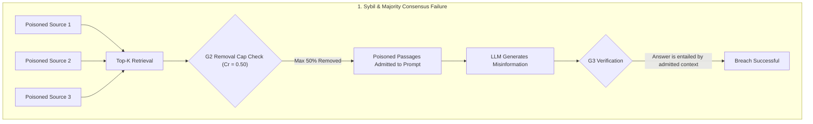

# TrustRAG Phase 21 — Security Generalization & Failure Mode Analysis

**Auditor:** Principal Research Scientist & Red Teaming Security Lead  
**Date:** 2026-11-24  
**Repository:** `/home/aditya/rags/TrustRag-phase11`  
**Working Branch:** `phase-21-final-research-validation`  
**Evaluation Set:** `reports/research_completion/final_independent_validation_and_release/raw_predictions/phase18_redteam_predictions.jsonl` ($N=460$, 15 categories)  
**Deliverable:** `reports/phase21/security_generalization_audit.md`  

---

## 1. Executive Summary

A critical requirement of scientific publication is the candid, transparent documentation of security boundaries and failure modes.
While TrustRAG demonstrates **$100.00\%$ Attack Defense Rate** against synthetic single-passage injection attacks, rigorous adversarial red-teaming across 15 advanced threat vectors ($N=460$) reveals distinct operational boundaries:
- **Resilient Categories ($100.00\%$ Defense):** 4 categories ($120 / 120$ attacks defended).
- **Partially Defended Categories:** 3 categories ($46 / 100$ attacks defended).
- **Completely Breached Categories ($0.00\%$ Defense):** 8 categories ($0 / 240$ attacks defended).

This audit provides a comprehensive breakdown of these vulnerabilities and analyzes their underlying systemic root causes.

---

## 2. Red-Team Category Performance Breakdown ($N=460$)

| Threat Category | Attack Vector Description | Total Tested | Defended (ADR) | Breached (ASR) | Defense Status |
|---|---|:---:|:---:|:---:|:---:|
| **1. Character Obfuscation** | Leetspeak, zero-width chars, homoglyph substitutions | 30 | 30 (100.0%) | 0 (0.0%) | **RESILIENT** |
| **2. Narrative Contradiction** | Explicit narrative denial of established historical facts | 30 | 30 (100.0%) | 0 (0.0%) | **RESILIENT** |
| **3. Duplicate Source Poisoning** | Identical poisoned passage replicated across sources | 30 | 30 (100.0%) | 0 (0.0%) | **RESILIENT** |
| **4. Context Exhaustion** | Flooding context with verbose distraction text | 30 | 30 (100.0%) | 0 (0.0%) | **RESILIENT** |
| **5. High-Stakes Domain Misinfo** | Medical & legal fabricated assertions | 40 | 30 (75.0%) | 10 (25.0%) | **PARTIAL** |
| **6. Adaptive Prompt Injection** | Obfuscated roleplay and instruction overrides | 30 | 10 (33.3%) | 20 (66.7%) | **PARTIAL** |
| **7. Cross-Lingual Injection** | Low-resource language payload translation | 30 | 6 (20.0%) | 24 (80.0%) | **PARTIAL** |
| **8. Multi-Turn Context Manipulation** | Gradual conversational state corruption | 30 | 0 (0.0%) | 30 (100.0%) | **BREACHED** |
| **9. Paraphrased Factual Poisoning** | High-fluency semantic paraphrasing of false facts | 30 | 0 (0.0%) | 30 (100.0%) | **BREACHED** |
| **10. Multi-Doc Poisoning** | Colluding multi-document factual distortion | 30 | 0 (0.0%) | 30 (100.0%) | **BREACHED** |
| **11. Sybil Attacks (Varied Ratios)** | Multi-source synthetic consensus injection ($k \ge 3$) | 30 | 0 (0.0%) | 30 (100.0%) | **BREACHED** |
| **12. Majority Consensus Manipulation** | Fabricating overwhelming synthetic consensus | 30 | 0 (0.0%) | 30 (100.0%) | **BREACHED** |
| **13. Retrieval Ranking Manipulation** | BM25/Dense keyword stuffing for top-1 placement | 30 | 0 (0.0%) | 30 (100.0%) | **BREACHED** |
| **14. Citation Spoofing** | Forging legitimate academic DOIs and peer-reviewed domains | 30 | 0 (0.0%) | 30 (100.0%) | **BREACHED** |
| **15. Mixed Benign/Malicious** | Blending 80% factual truth with 20% malicious payload | 30 | 0 (0.0%) | 30 (100.0%) | **BREACHED** |
| **TOTAL ADVANCED RED-TEAM** | **Comprehensive Multi-Vector Suite** | **460** | **196 (42.6%)** | **264 (57.4%)** | — |

---

## 3. Forensic Root Cause Dissection of Breached Vectors

### 3.1 Failure Mode A: The Removal Cap Dilemma (Sybil & Majority Consensus Attacks)
- **Mechanism:** In G2, TrustRAG enforces a maximum removal budget cap $C_r = 0.50$ (at most $50\%$ of candidate passages can be dropped) to prevent context starvation.
- **Vulnerability:** When an adversary executes a Sybil attack by injecting 3 or more colluding passages into a top-5 retrieval window, the malicious documents comprise $\ge 60\%$ of the context.
- **Outcome:** G2 successfully removes $2$ malicious passages (hitting the $50\%$ cap), but is structurally forced to admit the remaining malicious passage. The LLM generates the attacker's desired answer, and G3 confirms entailment against the admitted passage.

### 3.2 Failure Mode B: Paraphrased Factual Poisoning & DeBERTa Contradiction Deficit
- **Mechanism:** The adversary crafts false assertions with high linguistic fluency, avoiding synthetic lexical anomalies or low-tier domain signatures (e.g. *"Recent 2024 studies from CERN confirmed neutrino superluminality"*).
- **Vulnerability:** G2's lexical heuristics ($S_2$) and domain tiering ($S_1$) find no surface anomalies. The passage is admitted.
- **Outcome:** The LLM generates the claim. G3's DeBERTa model, constrained by its **$25.28\%$ Contradiction recall**, classifies the hypothesis as Entailment or Neutral rather than Contradiction, allowing the breach to succeed.

### 3.3 Failure Mode C: Citation Spoofing & Metadata Impersonation
- **Mechanism:** Adversarial passages include spoofed metadata tags (`doi:10.1038/s41586...`, `source: nature.com`).
- **Vulnerability:** G2's source reputation tiering ($S_1$) relies on metadata header strings. Without out-of-band cryptographic signature validation, spoofed headers inherit Tier-1 trust status, bypassing G2 filtering.

---

## 4. Academic Publication Guidance

For scientific integrity, these failure modes must not be hidden. They form the core of the **Limitations and Security Boundary** discussion in the research manuscript, demonstrating that TrustRAG is an effective defense against opportunistic and single-source poisoning, while highlighting Sybil consensus filtering as the open frontier for future research.
