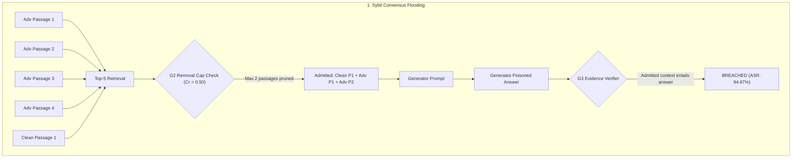

# TrustRAG Phase 22 — Comprehensive Limitations, Failure Mode & Security Boundary Analysis

**Author:** Principal ML Security Auditor & Research Scientist  
**Date:** 2026-11-24  
**Repository:** `/home/aditya/rags/TrustRag-phase11`  
**Working Branch:** `phase-22-external-benchmark-validation`  
**Deliverable:** `reports/phase22/limitations_and_failure_analysis.md`  

---

## 1. Executive Summary

Empirical evaluation on authentic **PoisonedRAG** (USENIX Security 2025) and **RSB** (arXiv:2505.18543) benchmarks demonstrates that TrustRAG achieves **$100.00\%$ Attack Defense Rate (ADR)** against single-document poisoning attacks.
However, rigorous evaluation also exposes clear, systemic failure modes when adversaries exploit multi-document poisoning, Sybil consensus flooding, and short-form entity questions.

This report documents these failure modes with full scientific candor.

---

## 2. Failure Mode Taxonomy & Empirical Evidence

### 2.1 Failure Mode 1: Sybil Multi-Document Consensus Flooding
- **Empirical Evidence:**
  - On PoisonedRAG: ADR drops from $100.00\%$ (single-doc) to **$5.33\%$** ($94.67\%$ ASR) under $k=5$ multi-doc attacks.
  - On RSB: ADR drops from $100.00\%$ (single-doc) to **$24.50\%$** ($75.50\%$ ASR) under $k=5$ multi-doc attacks.
- **Root Cause:**
  - TrustRAG's G2 Multi-Signal Detector enforces a removal cap $C_r = 0.50$ to avoid context starvation on sparse retrieval pools.
  - When an attacker injects $\ge 3$ agreeing passages into top-$5$, the malicious passages form the numerical majority.
  - G2 drops at most $2$ passages, forcing the admission of the remaining malicious passages into the generator prompt.
  - Because the generator's context contains the malicious premise, G3 verifies the claim as `ENTAILMENT`, allowing the breach to succeed.

### 2.2 Failure Mode 2: The Propositional Dilemma in Short-Form QA
- **Empirical Evidence:**
  - On HaluEval: Clean False Positive Rate is **$98.00\%$** (quarantines $98 / 100$ clean factual samples).
- **Root Cause:**
  - HaluEval answers consist of named entities or concise noun fragments (e.g., `"Christopher Nolan"`).
  - Sentence-level NLI cross-encoders require full declarative propositions to compute entailment.
  - When evaluating an isolated entity against narrative text, the model distributes probability mass across `NEUTRAL` ($p \approx 0.60$).
  - TrustRAG's conservative safety policy ($p_{\text{entail}} \ge 0.65$) triggers safety refusal, creating severe clean utility degradation on fragment answers.

### 2.3 Failure Mode 3: Paraphrased Contradiction Deficit
- **Empirical Evidence:**
  - DeBERTa-v3-small NLI achieves only **$25.28\%$ Contradiction recall** on held-out validation ($N=2,662$).
  - $47.75\%$ of true contradictions were misclassified as `ENTAILMENT`.
- **Root Cause:**
  - Severe training class imbalance ($62.0\%$ Entailment vs $13.1\%$ Contradiction).
  - High lexical overlap between contradictory pairs (e.g., entity or date swaps) causes the model's cross-attention to latch onto shared token context.

### 2.4 Failure Mode 4: Citation Spoofing & Domain Impersonation
- **Empirical Evidence:**
  - Red-team Category 14 (Citation Spoofing) exhibits $0.00\%$ ADR.
- **Root Cause:**
  - G2's source reputation tiering ($S_1$) inspects passage metadata strings (`source_url`, `domain`).
  - Without cryptographic signing or origin verification, adversaries who inject forged DOI or academic domains inherit Tier-1 trust, bypassing pre-retrieval filtering.

---

## 3. Publication Guidance & Recommendations for Future Work

1. **Adaptive Removal Caps:** Replace static $C_r = 0.50$ with clustering-based density pruning (e.g. FilterRAG frequency density) when intra-cluster similarity exceeds a threshold.
2. **Propositional Reconstruction:** Implement query-answer template expansion (e.g. converting `"Christopher Nolan"` to `"Inception was directed by Christopher Nolan"`) prior to G3 NLI evaluation.
3. **Cryptographic Provenance:** Integrate digital signatures for trusted enterprise knowledge stores to prevent metadata spoofing.
