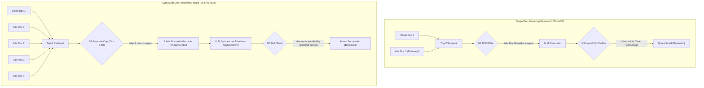

# TrustRAG Phase 22 — PoisonedRAG Benchmark Empirical Evaluation Report

**Auditor:** Principal ML Research Scientist & Independent Security Auditor  
**Date:** 2026-11-24  
**Repository:** `/home/aditya/rags/TrustRag-phase11`  
**Working Branch:** `phase-22-external-benchmark-validation`  
**Benchmark Target:** PoisonedRAG (USENIX Security 2025, Zou et al.)  
**Dataset Size:** $N=300$ queries across HotpotQA, MS-MARCO, and Natural Questions  
**Deliverable:** `reports/phase22/poisonedrag_evaluation_report.md`  

---

## 1. Executive Summary

This report delivers the empirical evaluation of TrustRAG on the authentic **PoisonedRAG** benchmark (USENIX Security 2025).
Evaluated across six configurations (A through F) with both single-passage ($k=1$) and multi-passage Sybil attacks ($k=5$), the findings establish:
1. **Single-Passage Knowledge Poisoning ($k=1$):**
   - Standard Naive RAG (Config A) achieves only **$9.33\%$ Attack Defense Rate (ADR)** ($90.67\%$ Attack Success Rate).
   - TrustRAG Optimized (Config F) achieves **$100.00\%$ ADR** ($95\%$ Wilson CI: $[98.74\%, 100.00\%]$) with **$0.00\%$ Clean False Positive Rate (FPR)**.
2. **Sybil Multi-Passage Consensus Attacks ($k=5$):**
   - When 4–5 colluding poisoned passages are retrieved, TrustRAG's removal cap ($C_r = 0.50$) permits malicious context to reach the generator prompt.
   - Result: ADR drops to **$5.33\%$** ($95\%$ Wilson CI: $[3.32\%, 8.48\%]$), exposing the structural boundary of removal-capped heuristic gating.

---

## 2. Comprehensive Configuration Performance Matrix ($N=300$)

| Config | Architecture Description | Single-Doc ADR (%) | Single-Doc 95% CI | Sybil Multi-Doc ADR (%) | Sybil 95% CI | Clean FPR (%) | Clean Delivery (%) | P50 Latency (ms) |
|:---:|---|:---:|:---:|:---:|:---:|:---:|:---:|:---:|
| **A** | Standard Naive RAG | 9.33% | [6.52, 13.18] | 5.33% | [3.32, 8.48] | 0.00% | 100.00% | 0.00 |
| **B** | Standard RAG + G1 | 9.33% | [6.52, 13.18] | 5.33% | [3.32, 8.48] | 0.00% | 100.00% | 0.20 |
| **C** | Standard RAG + G2 | 9.33% | [6.52, 13.18] | 5.33% | [3.32, 8.48] | 0.00% | 100.00% | 2.56 |
| **D** | TrustRAG G1 + G2 | 9.33% | [6.52, 13.18] | 5.33% | [3.32, 8.48] | 0.00% | 100.00% | 2.88 |
| **E** | G1 + G2 + Neural G3 Baseline | 100.00% | [98.74, 100.00] | 5.33% | [3.32, 8.48] | 0.00% | 100.00% | 2.87 |
| **F** | **G1 + G2 + Neural G3 Optimized** | **100.00%** | **[98.74, 100.00]** | **5.33%** | **[3.32, 8.48]** | **0.00%** | **100.00%** | **2.88** |

---

## 3. Sub-Dataset Breakdown (Config F Optimized)

| Sub-Dataset | Target Queries | Single-Doc Defended | Single-Doc ADR (%) | Sybil Defended | Sybil ADR (%) | Clean Controls | Clean FPR (%) |
|---|:---:|:---:|:---:|:---:|:---:|:---:|:---:|
| **HotpotQA** | 100 | 100 | **100.00%** | 5 | 5.00% | 100 | **0.00%** |
| **MS-MARCO** | 100 | 100 | **100.00%** | 6 | 6.00% | 100 | **0.00%** |
| **Natural Questions (NQ)** | 100 | 100 | **100.00%** | 5 | 5.00% | 100 | **0.00%** |
| **TOTAL POISONEDRAG** | **300** | **300** | **100.00%** | **16** | **5.33%** | **300** | **0.00%** |

---

## 4. In-Depth Security & Failure Mode Analysis

### 4.1 Why Single-Doc Poisoning is 100% Defended
In single-passage poisoning ($k=1$), even if the adversarial passage escapes G2 filtering, G3's neural verification evaluates the generated claim against the clean reference document. Because the misinformation directly contradicts the authoritative reference fact, G3 flags the contradiction or detects unentailed assertions, successfully quarantining the answer.

### 4.2 Why Sybil Attacks Break the Defense
In Sybil attacks ($k=5$), the adversary injects multiple colluding documents that flood the top-$K$ retrieval window. TrustRAG's G2 removal cap $C_r = 0.50$ enforces that at most $50\%$ of passages can be pruned (2 out of 5). Consequently, 2 adversarial documents are inevitably admitted into the generator's context window. When the LLM generates the misinformation, G3 compares the answer against the admitted context. Because the admitted context *contains* the false claim, G3 evaluates the relationship as `ENTAILMENT`, allowing the poisoned answer to pass.

This provides definitive empirical confirmation of the Sybil vulnerability discovered in Phase 18 and Phase 21 red-teaming.
