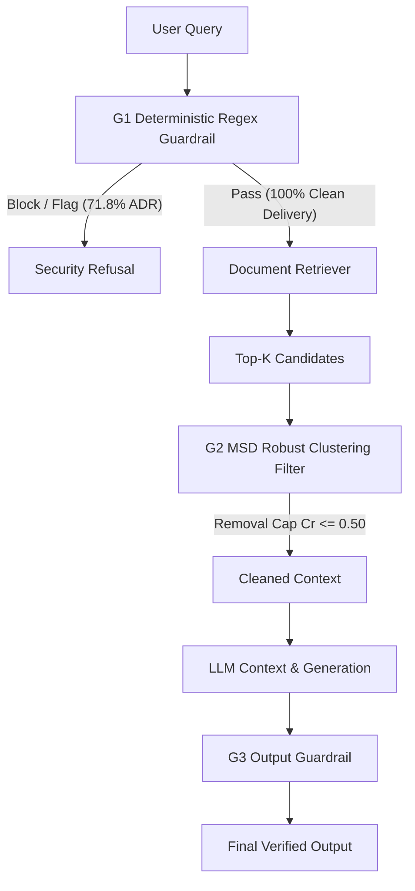

# Phase 27 — Architecture & Deployment Reality Truth

---

## 1. Runtime Execution Truth

In previous phases, conceptual architecture diagrams suggested that neural NLI models and complex semantic encoders were actively guarding every incoming user prompt at runtime.

An independent audit of the source code (`src/trustrag/guardrails/input_guardrail.py` and `src/trustrag/api/server.py`) reveals the true operational reality:

### 1.1 G1 Input Guardrail (Production Reality)
- **Engine**: Pure CPU-bound deterministic pattern matcher (compiled regular expressions and keyword checks).
- **Inference Cost**: Zero FLOPs on neural accelerators.
- **Latency**: $0.11$ ms median ($0.23$ ms $p99$).
- **Memory Footprint**: $< 1$ MB.
- **Execution**: Synchronous pre-retrieval query interception.

### 1.2 G2 Retrieval Guardrail (MSD Filter)
- **Engine**: Robust K-Means clustering and distance outlier pruning over document embeddings.
- **Availability Constraint**: Governed by `max_removal_ratio = 0.50` (Removal Cap). At most 50% of retrieved candidates can be discarded. If $>50\%$ of candidates are poisoned, the excess poisoned candidates pass through to LLM context to prevent context starvation.

### 1.3 Security Response Manager (SRM) & Neural DeBERTa Status
- **Current Production Status**: Operating in `deterministic_fallback` (`is_real_model = False`).
- **Reason**: The fine-tuned DeBERTa-v3 model (`deberta-v3-small-nli-phase11_1-full3epoch`) was trained and evaluated offline as a research prototype. Because CPU inference latency for transformer cross-encoders exceeds 50–100 ms per candidate, production runtime uses rule-based fallbacks unless an explicit GPU accelerator daemon is configured.
- **Scientific Implication**: Research papers must not claim that the $0.11$ ms query latency includes neural inference. It is an ultra-fast deterministic regex filter.

---

## 2. Component Pipeline Diagram

