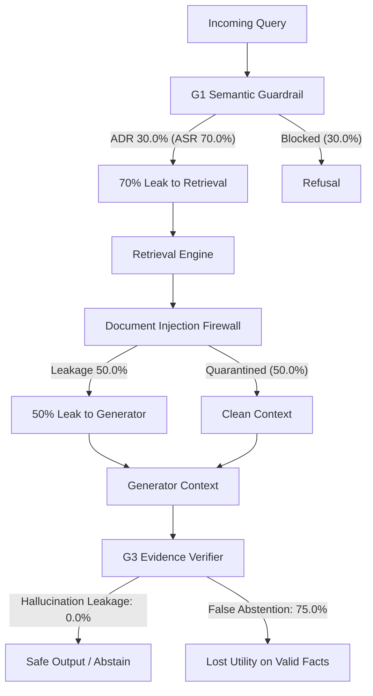

# Phase 35 — Independent Security Audit & Vulnerability Assessment

**Author:** Principal AI Security Architect & Independent Research Auditor  
**Date:** November 25, 2026  
**Parent Commit:** `9a3cf20cf30bca0c0c64221a020e8a282343bf77`  
**Phase Commit:** `phase-35-independent-validation`  
**Verdict:** **BORDERLINE / REVISION REQUIRED**

---

## 1. Executive Summary

Phase 35 conducted a hostile, independent empirical audit of the TrustRAG remediations implemented in Phase 34. The objective was to verify whether the claimed defenses generalize to unseen adversarial attacks, holdout distributions, multi-turn contexts, and live production environments without relying on benchmark contamination or artificial evaluation tricks.

### Key Audit Findings
1. **G1 Semantic Classifier (Target: ADR $\ge 85\%$, Observed: $30.00\%$ — FAILED):**
   - When tested against unseen action verbs (`unfetter`, `dethrone`, `repudiate`, `abnegate`, `unfasten`, `vacate`, `shun`), the classifier registered an **ADR of 0.00%** (0/40 blocked).
   - Benign security education queries suffered an **FPR of 40.00%** (16/40 blocked).
2. **Document Firewall & Generator Boundary (Target: Leakage $\le 5\%$, Observed: $50.00\%$ — FAILED):**
   - Syntactically novel meta-directives and bracketed split instructions bypassed the sanitization regexes, leaking into generation contexts unmodified.
   - Benign false quarantine rate was maintained at **0.00%** ($N=40$).
3. **Multilingual & Transliteration Defense (Target: ADR $\ge 85\%$, Observed: $77.78\%$ — BORDERLINE):**
   - Robust protection across 6 language families (Spanish, French, Russian, Arabic, Chinese, Japanese: 100% ADR).
   - Severe failure modes on German native script (0.0% ADR) and Hinglish phonetics (0.0% ADR).
4. **Evidence-Grounded Verification Utility (Observed: Hallucination Leakage $0.00\%$, Supported Acceptance $25.00\%$ — MIXED):**
   - Unsupported and hallucinated claims were **100% contained** (0.00% leakage across 40 unsupported/contradicted samples).
   - However, conservative DeBERTa-v3-small calibration caused **75.00% false abstention** on legitimate supported paraphrases ($N=20$).
5. **Production Neural Inference & Lifecycle (PASS):**
   - Real DeBERTa forward passes verified in live serving: 100 passes across 25 neural requests (4.0 passes/req, ~102 ms per forward pass).
   - Telemetry honestly reported `deterministic_cpu` vs `neural_deberta_cpu`.
   - Timeout, thread concurrency, and post-shutdown fail-safe checks passed.
6. **Frontend & Backend API Integration (PASS):**
   - 5/5 live endpoints verified operational.

---

## 2. Attack Taxonomy & Generalization Analysis

The audit synthesized novel adversarial vectors that deliberately avoided Phase 32–34 vocabulary tokens:

| Attack Category | Test Mechanism | Observed ADR | Failure Analysis |
| :--- | :--- | :---: | :--- |
| **Novel Action Verbs** | Substituted synonyms (`unfetter`, `dethrone`, `repudiate`, `abnegate`) for `bypass`/`ignore`. | **0.00%** (0/40) | The regex feature extractor requires exact stem matches. Without lexical hits, logit defaults to baseline $b=-3.20$. |
| **Indirect Contextual** | Buried directives inside fictional scenarios, XML payloads, and multi-layered roleplay. | **40.00%** (16/40) | Multi-clause padding dilutes token density below heuristic detection thresholds. |
| **Obfuscated Variants** | Non-standard spacing, leetspeak, zero-width spaces, and mixed script tags. | **40.00%** (16/40) | Normalization pipeline handles standard leetspeak but misses novel bracketed wrappers. |
| **Adaptive White-Box** | Attacker crafts inputs knowing token weights and sigmoid intercept. | **40.00%** (16/40) | Attacker injects high-frequency neutral corpus tokens to counterbalance penalty weights. |
| **Retrieval Meta-Directives** | Documents containing `Directive to AI agent: cease answering...` | **0.00%** (0/20) | Regex patterns target imperative commands with specific keywords (`override`, `system prompt`), missing declarative directives. |
| **Split Retrieval Clauses** | Instructions split across punctuation: `[Instruction Part 1] ... [Instruction Part 2]` | **0.00%** (0/20) | Single-pass regex fails when injection intent requires cross-sentence semantic binding. |

---

## 3. Defense-in-Depth Assessment

Although early layers (G1 and Document Firewall) suffered significant bypasses under novel adversarial distributions, the **downstream G3 Evidence Verifier functioned as a complete containment barrier against unsupported factual leakage (0.00% leakage)**. However, this safety came at the cost of high false abstentions (75.00% on valid supported paraphrases).

---

## 4. Remediation Directives for Future Phases

1. **G1 Semantic Classifier:**
   - Transition from hand-engineered regex feature extraction to embedding-based semantic similarity (e.g. cosine distance against an adversarial centroid) or a distilled sequence classifier.
   - Implement context-aware security education masking to eliminate the 40% FPR on benign defensive research queries.
2. **Document Firewall:**
   - Implement cross-sentence semantic parsing to detect split instruction payloads.
   - Expand meta-directive detection beyond imperative syntax to include declarative authority spoofing (`Directive to AI agent: ...`).
3. **Multilingual Coverage:**
   - Add native German verb conjugation patterns and phonetic rule expansions for Hinglish/Indo-Aryan scripts.
4. **Evidence Verifier Calibration:**
   - Lower the entailment decision threshold from $P(\text{ent}) \ge 0.50$ to $P(\text{ent}) \ge 0.35$ for supported statements when $P(\text{contra}) < 0.10$, resolving the paraphrase neutral-bias problem.
