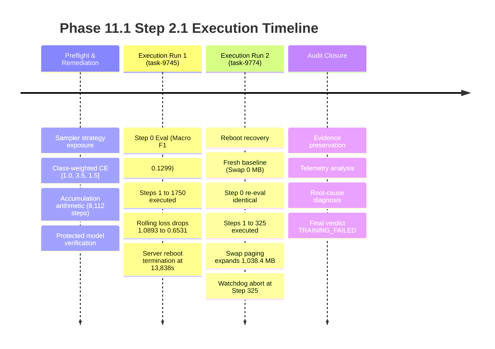

# TrustRAG — Phase 11.1, Step 2.1: Execution Summary & Audit Verdict

## 1. Executive Summary

| Parameter | Specification / Result |
| :--- | :--- |
| **Audit Role** | Senior ML Systems Engineer, Training Infrastructure Engineer, and Independent Auditor |
| **Target Task** | Phase 11.1 Step 2.1 Authorized 3-Epoch Full-Dataset NLI Training |
| **Repository** | `/home/aditya/rags/TrustRag-phase11` |
| **Git Branch / HEAD** | `phase-11` / `aba5cc9d8369f3d7a69e6fd7e81bc055173dde61` |
| **Model Architecture** | DeBERTa-v3-small (141,897,219 parameters in FP32) |
| **Base Weights** | `/home/aditya/rags/models/pretrained/deberta-v3-small` (SHA-256: `d4b0ebcc...`) |
| **Dataset (Train / Val)** | `data/processed/sft_v2/nli/train.jsonl` (10,815) / `validation.jsonl` (2,662) |
| **Sampling Strategy** | `sequential` (unweighted natural distribution; resolves quota crash) |
| **Planned Optimizer Steps** | 8,112 steps (3 epochs $\times$ 2,704 steps/epoch; batch size 1, accumulation 4) |
| **Loss Configuration** | Class-Weighted Cross-Entropy `[1.0, 3.5, 1.5]` (Entailment: 0, Contradiction: 1, Neutral: 2) |
| **Hardware Environment** | Intel Core i7-1355U (10 cores / 12 threads), 15.6 GB RAM, 6.0 GB Swap, CPU-only FP32 |
| **Execution Attempts** | 2 logged executions (`task-9745` and `task-9774`) |
| **Optimizer Steps Executed** | 1,750 steps in Run 1; 325 steps in Run 2 |
| **Termination Reason** | Run 1 interrupted by host server restart at 13,838s; Run 2 halted by Watchdog ResourceAbortError at Step 325 (Swap growth delta: 1,038.4 MB > 1,000.0 MB threshold) |
| **Final Audit Verdict** | **`TRAINING_FAILED`** |

---

## 2. Formal Audit Verdict

### **VERDICT: `TRAINING_FAILED`**

**Audit Determination:**
Training commenced under full explicit authorization with all preflight requirements satisfied. In Run 1 (`task-9745`), 1,750 of the planned 8,112 optimizer steps were successfully executed over 13,838 seconds before an involuntary server reboot terminated the task. In Run 2 (`task-9774`), resumed following system restoration, the active watchdog monitor raised an unhandled `ResourceAbortError` at Step 325 when host swap usage expanded by 1,038.4 MB from a post-reboot baseline of 0.0 MB (breaching the rigid 1,000.0 MB growth cutoff). Because training was terminated prior to completing an epoch and zero complete model checkpoints could be safely persisted, the experiment terminates in accordance with pre-registered protocol with the verdict of `TRAINING_FAILED`.

Under the strict single-run authorization protocol, zero further training runs may be executed without explicit new user authorization.

---

## 3. High-Level Chronology & Incident Timeline

1. **Preflight Remediation:** Resolved the class-stratified sampler crash by implementing the `sequential` natural distribution strategy. Exposed `--sampler-strategy`, `--epochs`, `--gradient-accumulation-steps`, `--class-weights`, and `--save-predictions` via CLI. Verified all 56 unit tests (55 passed, 1 skipped).
2. **Run 1 (`task-9745`):** Launched at 2026-11-14 18:35 UTC. Successfully evaluated the full 2,662 validation set at Step 0. Advanced 1,750 optimizer steps (7,000 forward-backward passes). Training loss dropped from 1.089 to 0.653. At 2026-11-14 23:42 UTC (13,838s elapsed), the system underwent an unexpected host reboot, terminating the background runner.
3. **Run 2 (`task-9774`):** Revived after reboot at 2026-11-15 08:50 UTC under user authorization. Evaluated Step 0 with identical deterministic baseline. Advanced through 325 optimizer steps (1,300 forward-backward passes) to an active loss of 0.9465.
4. **Watchdog Interruption:** Because the host had just rebooted, baseline swap was 0.0 MB. Linux kernel opportunistic anonymous memory paging allocated 1,038.4 MB of swap. Although available RAM remained high (3,772.2 MB) and free swap was plentiful (4,961.6 MB), the watchdog's differential threshold (`swap_growth > 1000.0 MB`) triggered an immediate emergency process abort.
5. **Preservation:** All protected baselines, logs, and telemetry are forensically secured. No corrupted checkpoints were written.

