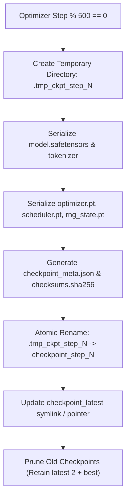

# TrustRAG — Phase 11.1, Step 2.2: Sub-Epoch Checkpoint Recovery & Resumption Architecture

## 1. Architectural Motivation & Problem Definition

In Phase 11.1 Step 2.1, the training harness executed 1,750 optimizer steps (13,838 seconds $\approx 3.84$ hours) of compute before an unexpected system reboot occurred. Because checkpoint serialization was designed to trigger strictly at epoch boundaries (every 2,704 steps $\approx 5.8$ hours on CPU), all 1,750 steps of forward-backward computation were lost.

To guarantee zero loss of compute time in future CPU campaigns, this document establishes the production design for sub-epoch atomic checkpointing, state restoration, and deterministic RNG resumption.

---

## 2. Comprehensive State Persistence Schema

Every periodic checkpoint directory (`checkpoint_step_{N}`) must contain the complete mathematical and computational state required to resume execution without perturbing the optimization trajectory:

```
checkpoint_step_0500/
├── config.json                     # HuggingFace architecture configuration
├── model.safetensors               # Serialized model parameters (FP32)
├── optimizer.pt                    # PyTorch AdamW state dict (momentum & variance tensors)
├── scheduler.pt                    # Learning rate schedule state (current step & warmup)
├── rng_state.pt                    # PyTorch, NumPy, and Python standard library RNG states
├── tokenizer_config.json           # DeBERTa SentencePiece tokenizer configuration
├── spm.model                       # Tokenizer vocabulary model
├── checkpoint_meta.json            # Step metadata, epoch offsets, loss history
└── checksums.sha256                # Cryptographic verification manifest
```

### 2.1 Complete State Dictionary Specification
```python
state_payload = {
    "version": "1.0",
    "step": opt_step,
    "epoch": current_epoch,
    "sample_index_in_epoch": step_idx,
    "accum_count": accum_count,
    "total_samples_processed": (current_epoch - 1) * len(train_records) + (step_idx + 1),
    "current_lr": current_lr,
    "rolling_loss": rolling_loss,
    "best_macro_f1": best_macro_f1,
    "best_val_loss": best_val_loss,
    "best_step": best_step,
    "rng_states": {
        "torch_cpu": torch.get_rng_state(),
        "numpy": np.random.get_state(),
        "python": random.getstate(),
    },
}
```

---

## 3. Atomic Serialization & Two-Stage Rotation Protocol

To prevent corrupted checkpoints from hard laptop power-offs or sudden host reboots, checkpoint writes must follow a strict two-stage atomic rename protocol:



### 3.1 Checkpoint Pruning Policy
To prevent disk exhaustion on the host NVMe partition:
- Retain the **2 most recent step checkpoints** (e.g., `checkpoint_step_1000/` and `checkpoint_step_1500/`).
- Retain the **best validation checkpoint** (`checkpoint_best/`).
- Automatically purge older step checkpoints after the new checkpoint is successfully committed and verified.

---

## 4. Exact Restoration & Resumption Workflow

When invoked with `--resume-from-checkpoint /path/to/checkpoint_dir` (or `--auto-resume`):

### 4.1 Checkpoint Verification & Integrity Validation
1. Verify existence of `checkpoint_meta.json`, `checksums.sha256`, and `model.safetensors`.
2. Compute SHA-256 hashes of all checkpoint components and compare against `checksums.sha256`.
3. If corruption is detected (e.g., due to an in-flight power loss):
   - Immediately log a warning.
   - Automatically fall back to `checkpoint_previous`.
   - Abort if all available checkpoints fail integrity verification.

### 4.2 State Restoration Sequence
```python
def resume_training_state(checkpoint_path: Path, model, optimizer, scheduler):
    # 1. Verify Cryptographic Integrity
    verify_checkpoint_checksums(checkpoint_path)
    
    # 2. Restore Model Weights
    model.load_state_dict(torch.load(checkpoint_path / "model.safetensors"))
    
    # 3. Restore AdamW Optimizer State (Momentum & Variance Tensors)
    opt_state = torch.load(checkpoint_path / "optimizer.pt", map_location="cpu")
    optimizer.load_state_dict(opt_state)
    
    # 4. Restore RNG State (Deterministic Continuation)
    rng_payload = torch.load(checkpoint_path / "rng_state.pt", map_location="cpu")
    torch.set_rng_state(rng_payload["torch_cpu"])
    np.random.set_state(rng_payload["numpy"])
    random.setstate(rng_payload["python"])
    
    # 5. Restore Progression Offsets
    meta = json.loads((checkpoint_path / "checkpoint_meta.json").read_text())
    return {
        "start_epoch": meta["epoch"],
        "start_step": meta["step"],
        "start_sample_idx": meta["sample_index_in_epoch"] + 1,
        "best_macro_f1": meta["best_macro_f1"],
        "best_val_loss": meta["best_val_loss"],
    }
```

### 4.3 Dataloader Fast-Forwarding
To prevent repeated forward-backward passes on previously consumed samples within the current epoch:
- Fast-forward the training loop iterator directly to `start_sample_idx`.
- Compute forward-backward passes starting from the exact unconsumed sample.
- Zero data re-shuffling or sample duplication occurs.

---

## 5. Fault-Tolerance Guarantees

| Failure Scenario | Previous Behavior | Proposed Architecture Behavior |
| :--- | :--- | :--- |
| **Laptop Reboot during Training** | 100% of progress in current epoch lost (up to 5.8h). | Automatically resumes from last 500-step checkpoint. Maximum compute lost: $\le 250\text{–}500$ steps ($\le 30\text{ minutes}$). |
| **Power Loss during Checkpoint Write** | Corrupt destination directory, unhandled crash on load. | Atomic rename ensures corrupt `.tmp` directory is ignored; runner loads previous verified checkpoint. |
| **User Manual Interruption (`Ctrl+C` / `SIGTERM`)**| Immediate termination without checkpointing. | Signal handler catches `SIGINT`/`SIGTERM`, writes emergency checkpoint `checkpoint_interrupted/`, and exits cleanly. |

