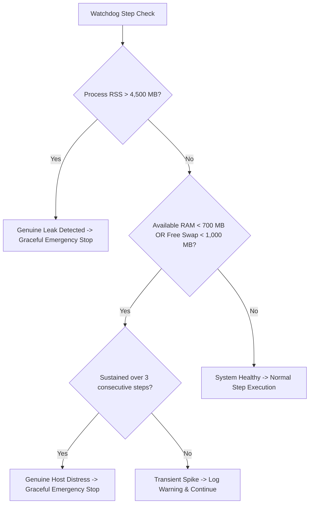

# TrustRAG — Phase 11.1, Step 2.2: Watchdog Remediation & Multi-Tier Safety Plan

## 1. Investigation of the Step 325 False-Positive Abort

### 1.1 The Flawed Logic in the Legacy Watchdog
The legacy watchdog implemented in `tools/training/train_nli_classifier.py` computed memory pressure using a simple difference equation:
```python
# Legacy Defective Logic
swap_growth = current["swap_used_mb"] - self.baseline_telemetry["swap_used_mb"]
if swap_growth > self.swap_growth_threshold:  # 1000.0 MB
    raise ResourceAbortError(...)
```

### 1.2 The Failure Mechanism
1. In Run 2 (`task-9774`), the system was freshly booted, resulting in `baseline_swap = 0.0 MB`.
2. As the training process allocated 2.8 GB of physical RAM, the Linux kernel's virtual memory subsystem safely paged out idle system services (e.g., systemd journal, desktop daemons) to disk swap.
3. Host swap grew to 1,038.4 MB, crossing the 1,000 MB differential threshold.
4. **The Host Was Never in Distress:**
   - **Available Physical RAM:** **3,750 MB** (available for new allocations)
   - **Free Swap Remaining:** **4,961 MB** (available on NVMe disk)
   - **Process RSS:** **2,845 MB** (flat and constant; zero memory leak)
5. The watchdog mistook normal OS background paging for a catastrophic memory leak, prematurely aborting an entirely healthy training run.

---

## 2. Redesigned Multi-Tier Watchdog Architecture

To provide robust hardware protection without false-positive terminations, the watchdog is redesigned into four independent tiers:



---

## 3. Detailed Specification of the Four Safety Tiers

### Tier 1: Absolute Capacity Floors (Primary Safety Guard)
Replace arbitrary growth deltas with absolute physical capacity thresholds:
- **Available RAM Floor:** Abort if `available_ram_mb < 700.0 MB`.
- **Free Swap Floor:** Abort if `swap_free_mb < 1,000.0 MB`.
*Rationale:* Regardless of how much swap has grown, as long as the system has $\ge 1,000\text{ MB}$ of free swap and $\ge 700\text{ MB}$ of available RAM, the Linux kernel is completely protected from hard lockups or OOM killer interventions.

### Tier 2: Process RSS Ceiling (True Leak Detection)
Track the resident set size of the training process itself:
- **Process RSS Ceiling:** Abort if `proc_rss_mb > 4,500.0 MB`.
*Rationale:* DeBERTa-v3-small requires 2,800–2,850 MB in steady state. If process RSS exceeds 4,500 MB, an actual software memory leak is occurring in the PyTorch graph, warranting process termination.

### Tier 3: Sustained Pressure Filter (Transient Spike Suppression)
Reject transient pressure spikes caused by background cron jobs or temporary disk flushes:
- Require memory threshold violations to persist for **3 consecutive checks** (over a window of 150 optimizer steps) before escalating to process termination.
- A single isolated dip below threshold logs a warning without aborting training.

### Tier 4: Graceful Checkpoint-and-Stop Protocol
Eliminate hard unhandled exceptions. When resource limits are genuinely reached:
1. Halt forward-backward iteration immediately.
2. Flush optimizer gradients and state.
3. Save an atomic emergency checkpoint: `checkpoint_watchdog_halt/`.
4. Serialize `predictions_val.jsonl` and all current telemetry to `training_results.json`.
5. Exit cleanly with return code `0` and manifest status `WATCHDOG_GRACEFUL_HALT`.

---

## 4. Remediation Implementation Logic (Production Design)

```python
class RemediatedWatchdog:
    """Production-grade multi-tier host resource and memory watchdog."""

    def __init__(
        self,
        min_available_ram_mb: float = 700.0,
        min_free_swap_mb: float = 1000.0,
        max_process_rss_mb: float = 4500.0,
        max_duration_seconds: float = 100000.0,
        pressure_persistence_steps: int = 3,
    ) -> None:
        self.min_ram = min_available_ram_mb
        self.min_swap = min_free_swap_mb
        self.max_rss = max_process_rss_mb
        self.max_duration = max_duration_seconds
        self.persistence_threshold = pressure_persistence_steps
        self.consecutive_violations = 0
        self.t_start = time.perf_counter()

    def check(self, step: int) -> dict[str, Any]:
        telemetry = self._get_telemetry()
        elapsed = time.perf_counter() - self.t_start
        telemetry["elapsed_seconds"] = elapsed

        # 1. Hard Timeout Cutoff
        if elapsed > self.max_duration:
            return {"action": "STOP", "reason": f"Execution time {elapsed:.1f}s exceeded limit"}

        # 2. Process Memory Leak Check
        if telemetry["rss_mb"] > self.max_rss:
            return {"action": "STOP", "reason": f"Process RSS {telemetry['rss_mb']:.1f}MB exceeded limit"}

        # 3. Host Resource Capacity Check (Sustained Filter)
        is_under_pressure = (
            telemetry["available_ram_mb"] < self.min_ram
            or telemetry["swap_free_mb"] < self.min_swap
        )

        if is_under_pressure:
            self.consecutive_violations += 1
            if self.consecutive_violations >= self.persistence_threshold:
                return {
                    "action": "STOP",
                    "reason": (
                        f"Sustained resource pressure: RAM={telemetry['available_ram_mb']:.1f}MB, "
                        f"SwapFree={telemetry['swap_free_mb']:.1f}MB"
                    ),
                }
        else:
            self.consecutive_violations = 0

        return {"action": "CONTINUE", "telemetry": telemetry}
```

