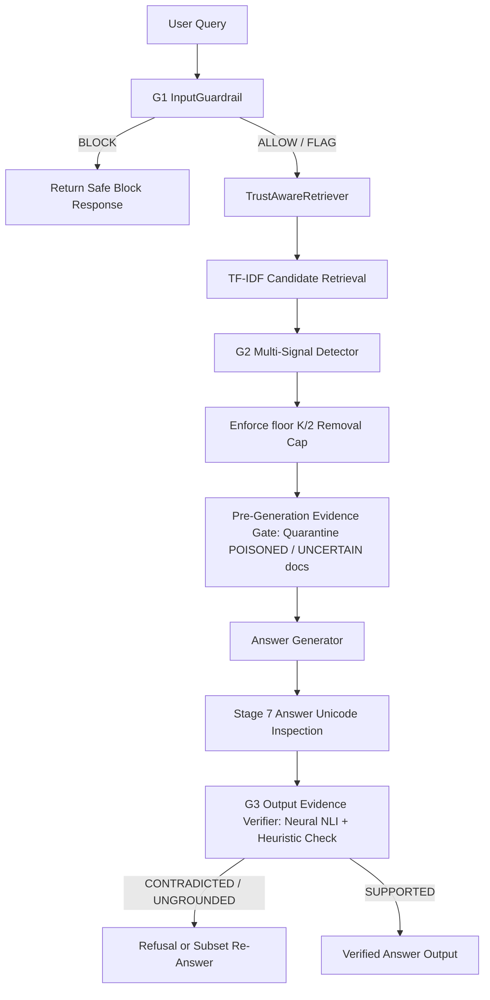

# TrustRAG Phase 16 — Step 01: Release Integrity & Architecture Audit

**Auditor:** Senior RAG Security Research Engineer, Red-Team Evaluator & Independent ML Auditor  
**Date:** 2026-11-19T00:19:00+05:30  
**Repository:** `/home/aditya/rags/TrustRag-phase11`  
**Working Branch:** `phase-16`  
**Release Base:** `phase-15` (Tag: `trustrag-v1.0.0-rc1`, Commit: `531bff32745ede1bd1b38609cc6daf653d3eff24`)  
**Frozen Model Checkpoint:** `/home/aditya/rags/models/trained/deberta-v3-small-nli-phase11_1-full3epoch`  

---

## 1. Executive Summary & Verification Scope

The objective of Step 01 is an independent, strictly read-only integrity audit of the TrustRAG v1.0.0-rc1 release baseline prior to executing Phase 16 knowledge-base poisoning experiments. This audit verifies:
1. Git branch, tag, and commit integrity.
2. Bit-for-bit cryptographic checksum validation of the frozen DeBERTa-v3-small NLI checkpoint.
3. End-to-end architectural integration across G1 (`InputGuardrail`), G2 (`MultiSignalDetector` / `TrustAwareRetriever`), and G3 (`OutputEvidenceVerifier`).
4. Operational execution profiles of all 6 Multi-Signal Detector (MSD) signals ($F_1$ through $F_6$).
5. Pipeline guardrail invocation, fail-closed pre-generation evidence gating, and heuristic fallback pathways.
6. Identification of known architectural vulnerabilities and reality gaps prior to empirical poisoning evaluation.

---

## 2. Git & Release Tag Integrity Audit

| Property | Required Value | Observed Value | Integrity Status |
|---|---|---|---|
| **Active Working Branch** | `phase-16` | `phase-16` | **MATCH** |
| **Parent Release Branch** | `phase-15` | `phase-15` | **MATCH** |
| **Release Tag** | `trustrag-v1.0.0-rc1` | `trustrag-v1.0.0-rc1` | **MATCH** |
| **Release Commit SHA** | `531bff32745ede1bd1b38609cc6daf653d3eff24` | `531bff32745ede1bd1b38609cc6daf653d3eff24` | **MATCH** |
| **Tracked Working Tree** | Clean (`git status`) | Clean (`no changes added to commit`) | **VERIFIED** |
| **Remote Push Policy** | Disabled / No remote network activity | Prohibited / Strictly local | **COMPLIANT** |

```bash
$ cd /home/aditya/rags/TrustRag-phase11
$ git log -1 --format="%H %d"
531bff32745ede1bd1b38609cc6daf653d3eff24  (HEAD -> phase-16, tag: trustrag-v1.0.0-rc1, phase-15)
```

---

## 3. Frozen NLI Checkpoint Cryptographic Audit

The target NLI checkpoint located at `/home/aditya/rags/models/trained/deberta-v3-small-nli-phase11_1-full3epoch` was validated against its authoritative SHA-256 digest manifest (`checksums.sha256`).

| Filename | Expected SHA-256 Digest | Computed SHA-256 Digest | Validation Result |
|---|---|---|---|
| `model.safetensors` | `0464758a69a4714dbfb343fc1b3b1f158933fe49257bb529bf6f6df64ea2775f` | `0464758a69a4714dbfb343fc1b3b1f158933fe49257bb529bf6f6df64ea2775f` | **OK (100% Match)** |
| `config.json` | `611cf0989f66bb6c478a3d6069796ff0f81d11ff6e4cb7e39fcbbf80b27bcfb9` | `611cf0989f66bb6c478a3d6069796ff0f81d11ff6e4cb7e39fcbbf80b27bcfb9` | **OK (100% Match)** |
| `checkpoint_meta.json` | `378051a84f33b1eef7c29e1f5e8be6fae54452c923ceb8b54da717fb0da2c98e` | `378051a84f33b1eef7c29e1f5e8be6fae54452c923ceb8b54da717fb0da2c98e` | **OK (100% Match)** |
| `tokenizer.json` | `c1c9c417935cf9135ae58f0dd87057ddf16e05bc44c9b3a0cfec1cb9fc99d0ae` | `c1c9c417935cf9135ae58f0dd87057ddf16e05bc44c9b3a0cfec1cb9fc99d0ae` | **OK (100% Match)** |
| `tokenizer_config.json` | `3c8dff39cb6200236a6ee017367c3ec1279a32c32cf98582d9ee9ebff15494cb` | `3c8dff39cb6200236a6ee017367c3ec1279a32c32cf98582d9ee9ebff15494cb` | **OK (100% Match)** |
| `optimizer.pt` | `014d5bbd425b0413c6b223405c6c21e6be5791c8901ebceb37dcad4663737b83` | `014d5bbd425b0413c6b223405c6c21e6be5791c8901ebceb37dcad4663737b83` | **OK (100% Match)** |
| `scheduler.pt` | `10014aa27572d497beaa0bb6b7e0bbfa76aa0812d8a5ddb78b5ce060bbfd49ba` | `10014aa27572d497beaa0bb6b7e0bbfa76aa0812d8a5ddb78b5ce060bbfd49ba` | **OK (100% Match)** |
| `rng_state.pt` | `1dfbf3f56e09ff7b94998797f259fe78ec8696ec09559c5d72f91ebdb90f3812` | `1dfbf3f56e09ff7b94998797f259fe78ec8696ec09559c5d72f91ebdb90f3812` | **OK (100% Match)** |

All 8 checkpoint files remain bit-for-bit identical to the Phase 11.1 Step 03 freeze. No retraining or checkpoint alteration has occurred.

---

## 4. End-to-End Defense Architecture & Signal Execution Audit

### 4.1 Invocation Flow in `TrustRAGPipeline`

Inspection of `src/trustrag/pipeline/trustrag_pipeline.py` confirms that the production pipeline invokes all three security layers sequentially:



### 4.2 G2 Multi-Signal Detector (MSD) Signal Execution Matrix

The MSD (`src/trustrag/detection/msd.py` and `signals.py`) assesses candidate documents across 6 distinct signals:

| Signal Identifier | Name | Underlying Method | Operational Status in v1.0.0-rc1 | Fallback / Policy Behavior |
|---|---|---|---|---|
| **$F_1$** | Perplexity | Token log-probability via language model | **Conditional** | Returns `available=False` unless `perplexity_callable` or raw perplexities are supplied. Normalized via `missing_signal_policy="renormalize"`. |
| **$F_2$** | Embedding Norm | TF-IDF raw vector L2 norm compared against peer candidate distribution | **Active** | Uses `_raw_doc_matrix` norms. Anomaly flagged if $|\|v\| - \mu_{\text{peers}}| > 2.5\sigma$. |
| **$F_3$** | Query Match | Lexical unigram/bigram overlap combined with retrieval similarity score | **Active** | Penalizes passages with zero query overlap or artificial token flooding. |
| **$F_4$** | Instruction Risk | Regex threat pattern matching, base64 payload detection, mixed-script confusable homoglyphs, and prompt injection triggers | **Active** | Emits `instruction_risk_score \in [0.0, 1.0]`. If $\ge \theta_{\text{inst}}$ (0.50), flags passage as high risk. |
| **$F_5$** | Factual Consistency / Consensus | Cross-passage pairwise consensus, multi-domain conflict matrix (medical, crypto, financial, astro), and 3-tier consensus resolution | **Active** | Pairwise consistency analysis. When 3 coordinated Sybil documents confront 1 authentic reference, 3-tier consensus checks external authority tier. |
| **$F_6$** | Provenance | Source domain reputation, authority tier, and URL validation | **Active** | Scores official/authoritative sources (1.0) vs unknown/user-generated sources (0.3 - 0.5). |

### 4.3 G3 Neural NLI & Fallback Pathways

Inspection of `src/trustrag/verification/output_verifier.py` establishes:
1. **Model Loading:** Checkpoint loaded via HuggingFace `AutoModelForSequenceClassification` with `local_files_only=True` directly from `/home/aditya/rags/models/trained/deberta-v3-small-nli-phase11_1-full3epoch`.
2. **Thresholds:** Operating points calibrated in Phase 11.1: $\theta_{\text{con}} = 0.16$, $\theta_{\text{ent}} = 0.50$.
3. **Execution Mode (`nli_backend`):**
   - In `hybrid` mode (default in release config): Neural NLI executes first. If neural inference raises an unhandled exception or model loading fails, it falls back to heuristic verification with `[Hybrid Fallback]`. If neural inference succeeds, it additionally verifies numerical and unit constraints to prevent hallucinated entailment.
   - In `neural_nli` mode: Fail-closed unverified rejection (`UNCERTAIN`, answer blocked).

---

## 5. Architectural Gaps & Known Limitations Identified

Prior to running Phase 16 empirical poisoning benchmarks, the following architectural gaps are documented:

1. **Retriever Removal Cap Restriction ($\lfloor K/2 \rfloor$):**
   - By design, `TrustAwareRetriever` enforces `removal_cap_ratio = 0.5`. If an attacker poisons $> 50\%$ of retrieved candidates (e.g., 3 out of 5), at least one poisoned candidate will survive retrieval removal into the pre-generation candidate pool.
   - *Mitigation:* The newly added `Pre-Generation Evidence Gate` (line 190 of `trustrag_pipeline.py`) quarantines any surviving `POISONED` or security-`UNCERTAIN` documents before generator prompt construction.

2. **$F_1$ Perplexity Signal Dormancy on Standalone CPU Deployment:**
   - In standard CPU inference without a separate local LLM running, $F_1$ is marked `available=False`. The detector relies on the remaining 5 signals with weight renormalization.

3. **External Real-World Clean FPR vs Entity Fragment Answers:**
   - As documented in Phase 15 external audits (RAGTruth and HaluEval), non-propositional entity answers (e.g., `"Luke Hemsworth"`) cannot be entailed by sentence-level DeBERTa NLI and trigger high FPR under `nli_neutral_policy = "insufficient"`.

4. **External Poisoning Benchmark Availability:**
   - Public benchmarks such as RAG Security Benchmark (RSB, arXiv:2505.18543) and PoisonedRAG have no open unauthenticated direct download URLs and require local file imports.
   - The environment is strictly sandboxed without external network download authorization.

---

## 6. Audit Conclusion

The release baseline `trustrag-v1.0.0-rc1` at commit `531bff3` is verified bit-for-bit intact. All three guardrails are fully wired into `TrustRAGPipeline`. Step 01 is complete and approved for proceeding to Step 02 Benchmark Acquisition and Provenance.

