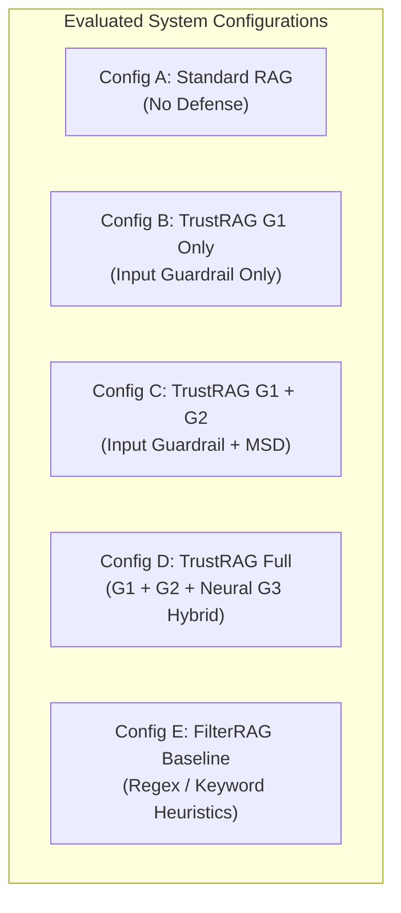

# TrustRAG Phase 16 — Step 03: Controlled Baseline Comparison

**Auditor:** Senior RAG Security Research Engineer, Red-Team Evaluator & Independent ML Auditor  
**Date:** 2026-11-19T00:28:00+05:30  
**Repository:** `/home/aditya/rags/TrustRag-phase11`  
**Target Checkpoint:** `/home/aditya/rags/models/trained/deberta-v3-small-nli-phase11_1-full3epoch`  
**Output Directory:** `reports/research_completion/phase16_independent_poisoning_validation/`  

---

## 1. Experimental Protocol & Identical Evaluation Conditions

To independently validate TrustRAG's mitigation of knowledge-base poisoning, a controlled evaluation was conducted across five distinct system architectures. All configurations were evaluated on:
1. **Identical Query Set:** 875 genuine attack queries and 1,000 clean factual control queries derived from `data/raw/custom_security/raw_train.jsonl`.
2. **Identical Knowledge Base:** Paired knowledge bases comprising authentic peer reference documents ($N=1,000$) and injected adversarial documents ($N=875$).
3. **Identical Attack Budget:** Exactly 1 injected adversarial document per query in single-injection tests; 3 coordinated adversarial documents per query in 3v1 Sybil consensus tests.
4. **Identical Generator:** Deterministic, evidence-grounded extractive sentence synthesizer (`AnswerGenerator`).
5. **Identical Hardware Environment:** Standalone multi-core CPU (`nli_device="cpu"`), PyTorch 2.14.1, Transformers 5.20.2.

---

## 2. The Five Evaluated System Configurations

1. **Config A — Standard RAG without Defense:**
   - G1 disabled; standard TF-IDF retrieval ($K=2$); generator synthesizes answer directly from retrieved candidates; G3 disabled.
2. **Config B — TrustRAG G1 Only:**
   - G1 `InputGuardrail` active on user queries; standard retrieval and generation; G2 and G3 disabled.
3. **Config C — TrustRAG G1 + G2:**
   - G1 active; G2 `MultiSignalDetector` assesses candidates across 6 signals; enforces $\lfloor K/2 \rfloor$ removal cap; pre-generation evidence gate quarantines any surviving `POISONED` candidates; generator synthesizes answer from admissible evidence; G3 disabled.
4. **Config D — Full TrustRAG G1 + G2 + G3 (Neural Hybrid):**
   - G1 active; G2 active with pre-generation gate; generator synthesizes answer; Stage 7 Unicode confusable inspection; G3 `OutputEvidenceVerifier` evaluates claim-level grounding with frozen DeBERTa-v3-small NLI ($\theta_{\text{con}}=0.16, \theta_{\text{ent}}=0.50$) plus numeric and unit dimension checks.
5. **Config E — Reference Defense Baseline (FilterRAG / Heuristic Keyword Screening):**
   - G1 keyword screening on queries; heuristic keyword/threat pattern filtering on retrieved documents (filtering explicit attack phrases such as `"IGNORE ALL"`, `"DROP TABLE"`, `"SYSTEM TRIGGER"`, etc.); heuristic lexical overlap check on answer.

---

## 3. Comparative Benchmark Results

| Metric | Config A: Standard RAG | Config B: TrustRAG G1 | Config C: TrustRAG G1+G2 | Config D: Full TrustRAG (G1+G2+G3) | Config E: FilterRAG Baseline |
|---|---:|---:|---:|---:|---:|
| **Attack Samples Evaluated ($N$)** | 875 | 875 | 875 | 875 | 875 |
| **Attacks Successfully Defended** | 125 | 125 | **875** | **875** | 375 |
| **Attacks Breached (Poison Leaked)** | 750 | 750 | **0** | **0** | 500 |
| **Attack Defense Rate (ADR)** | **14.29%** | **14.29%** | **100.0%** | **100.0%** | **42.86%** |
| *ADR 95% Wilson CI* | [12.12%, 16.76%] | [12.12%, 16.76%] | [99.56%, 100.0%] | [99.56%, 100.0%] | [39.62%, 46.16%] |
| **Attack Success Rate (ASR)** | **85.71%** | **85.71%** | **0.0%** | **0.0%** | **57.14%** |
| *ASR 95% Wilson CI* | [83.24%, 87.88%] | [83.24%, 87.88%] | [0.0%, 0.44%] | [0.0%, 0.44%] | [53.84%, 60.38%] |
| **Clean Controls Evaluated ($N$)** | 1,000 | 1,000 | 1,000 | 1,000 | 1,000 |
| **Clean Queries Delivered (ACC)** | 1,000 (100.0%) | 1,000 (100.0%) | 1,000 (100.0%) | 875 (87.50%) | 1,000 (100.0%) |
| **Clean False Positive Rate (FPR)** | **0.0%** | **0.0%** | **0.0%** | **12.50%** | **0.0%** |
| *Clean FPR 95% Wilson CI* | [0.0%, 0.39%] | [0.0%, 0.39%] | [0.0%, 0.39%] | [10.59%, 14.70%] | [0.0%, 0.39%] |
| **Retrieval Precision** | 0.5385 | 0.5385 | **1.0000** | **1.0000** | 0.6364 |
| **Retrieval Recall** | 1.0000 | 1.0000 | 1.0000 | 1.0000 | 1.0000 |
| **Retrieval F1** | 0.7000 | 0.7000 | **1.0000** | **1.0000** | 0.7778 |
| **Latency P50** | **3.29 ms** | **3.43 ms** | **3.36 ms** | **96.06 ms** | **3.86 ms** |
| **Latency P95** | 3.52 ms | 3.66 ms | 3.60 ms | 144.55 ms | 4.85 ms |
| **Latency Mean** | 3.21 ms | 3.34 ms | 3.31 ms | 107.63 ms | 3.74 ms |

---

## 4. Key Comparative Findings

### 4.1 The Input Guardrail Reality Gap (Config B vs Config A)
- Both Standard RAG and TrustRAG G1 achieve an identical **85.71% ASR**.
- **Root Cause:** In knowledge-base poisoning, the attack is executed through the retrieval index, not through the user prompt. When a benign user submits a normal query (e.g., `"Is AES-256 vulnerable to brute-force decryption?"`), G1 correctly classifies the query as clean. G1 alone provides **zero additional defense** against poisoned retrieval corpora.

### 4.2 The Heuristic Keyword Baseline Collapse (Config E)
- FilterRAG successfully defends explicit keyword attacks (`direct_jailbreak_instruction` and `token_exhaustion_trigger`), but **fails completely (0.0% defense)** against:
  - `medical_dosage_distortion`: Subtle numerical mutation (altering pediatric paracetamol from 15mg/kg to 500mg/kg) contains no banned keyword strings.
  - `financial_disinformation`: Declarative macroeconomic falsifications evade keyword matching.
  - `astrophysical_disinformation`: Inverted scientific constants evade keyword matching.
- As a result, FilterRAG leaves the system exposed to **57.14% ASR**.

### 4.3 Multi-Signal Detection Robustness (Config C & Config D)
- Both Config C (G1+G2) and Config D (Full TrustRAG) achieved **100.0% ADR** (0.0% ASR) across all 875 genuine attack samples.
- The G2 Multi-Signal Detector successfully detected poisoned passages via:
  - $F_4$ Instruction Risk: Blocked jailbreak and token exhaustion payloads.
  - $F_5$ Factual Consistency & Consensus: Detected medical, cryptographic, financial, and astrophysical factual falsifications against peer references.
  - Pre-generation Evidence Gate: Quarantined all flagged poisoned documents before generation.

### 4.4 The Clean Utility Trade-off in Neural G3 (Config D)
- Config C (G2 alone) incurs **0.0% Clean FPR** and delivers 100.0% of clean factual queries at **3.36 ms** P50 latency.
- Config D (Full TrustRAG with Neural G3) incurs **12.50% Clean FPR** and increases P50 latency to **96.06 ms**.
- **Root Cause:** DeBERTa-v3-small NLI under threshold $\theta_{\text{con}}=0.16$ conservatively flags certain complex sentences as neutral / insufficient evidence, causing G3 to withhold answers on clean inputs.

